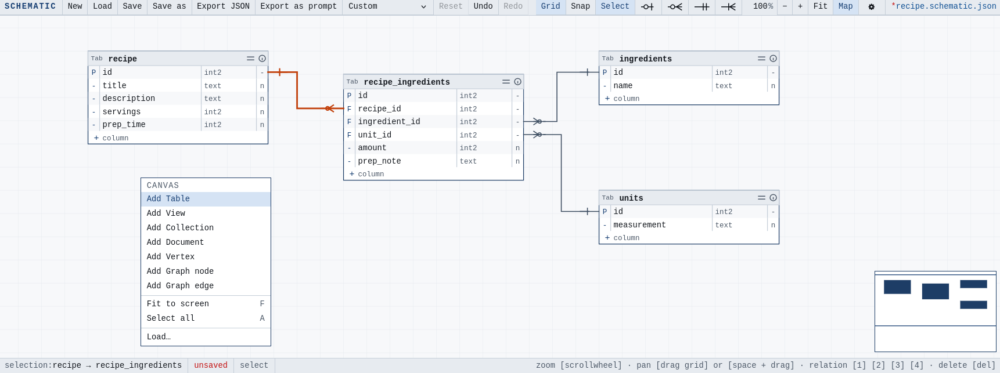
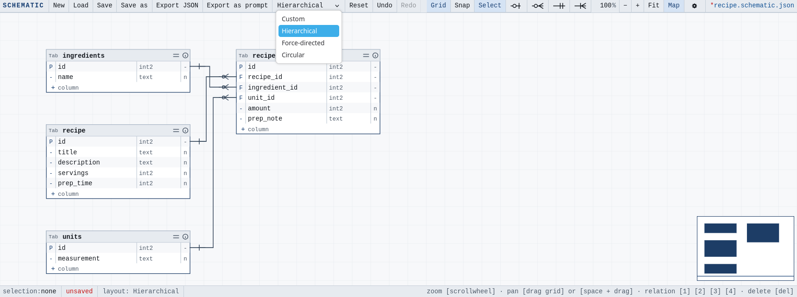
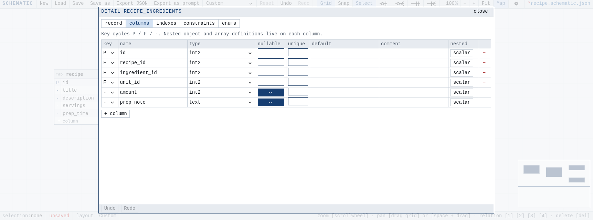
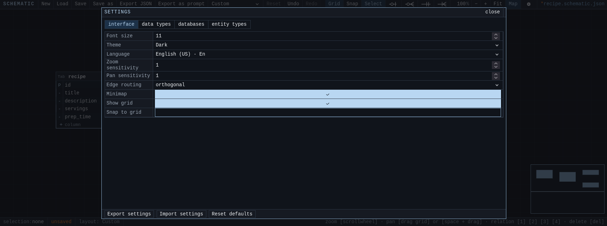
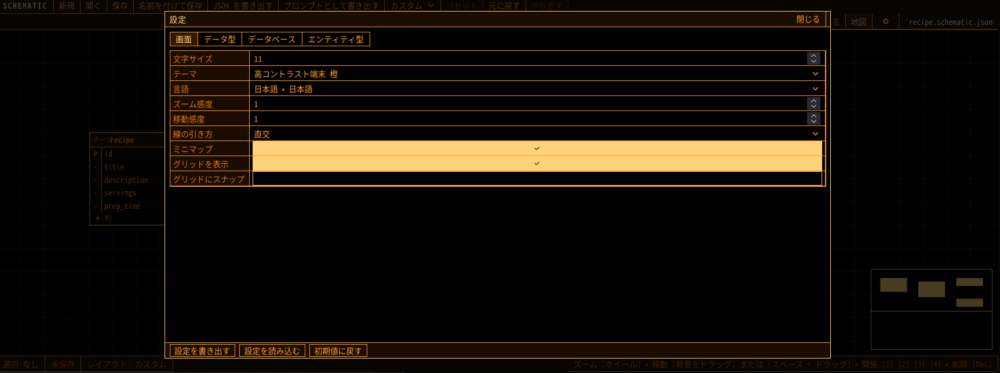
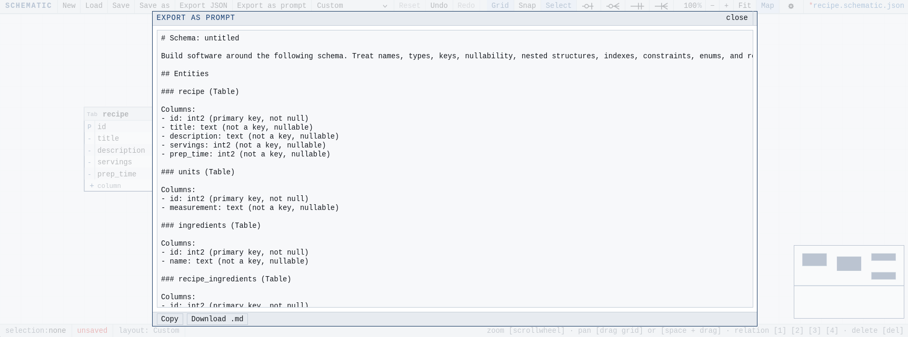
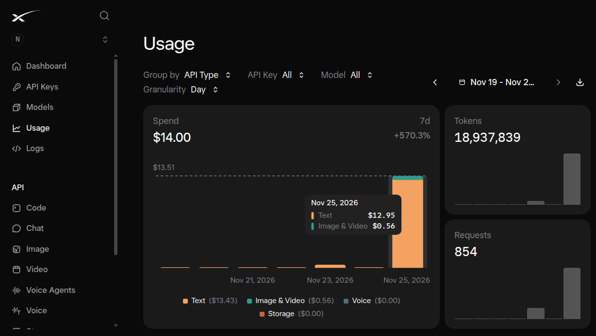
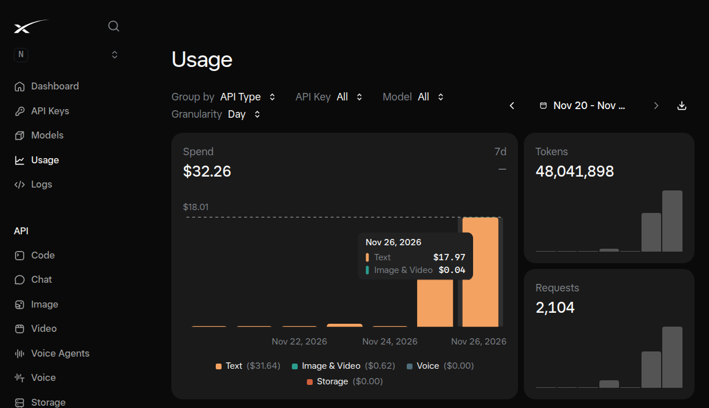

# Schematic

Browser-based data schema designer, using single-page HTML + CSS + TypeScript (Grok Build vibe-coded and framework-free).


## Overview

Largely based on another project, **[ERD Editor by SeungHwan-Lee](https://github.com/dineug/erd-editor)**. This watered-down version does not interoperate with other tools like the original does. It exports its own custom JSON and an AI prompt version of your schema. Intended as an ideation tool.

This tool helps you be economic with AI token credits by clearly defining your data points and relationships as thoroughly as possible upfront. Submit your completed data schema as a prompt to your AI tool and build the app around it. This workflow can be more token cost efficient than repeated refactoring around the foundational data structure.


## Feature summary (by Grok)

* **Design schemas visually**: Create tables and other entity types, add columns, set keys, data types, and nullability, and see everything update live on an interactive canvas.



* **Draw real relationships**: Use standard **[crow’s-foot notation](https://grokipedia.com/page/Entity%E2%80%93relationship_model#crows-foot-notation)** to connect columns. Relations are drawn cleanly and stay attached as you move things around.

* **Work the way you want**: Drag entities freely, or switch between automatic layouts including Hierarchical, Force-directed, and Circular. Each layout remembers its own positions, and you can reset any algorithmic layout at any time. Your manual Custom arrangement is always preserved.



* **Edit in depth without clutter**: Open a resizable detail panel for any entity to manage extra information, including comments, indexes, constraints, enums, nested objects, and arrays. Everything autosaves.



* **Stay organised**: Toggle a background grid, turn snapping on or off, zoom with the mouse wheel or pinch gesture, and pan freely. The interface stays usable on both desktop and touch screens.

* **Make it yours**: Switch between professional light, dark, and high-contrast themes. Change font size, language, and other preferences. All labels are translatable.





* **Export for real work**: Save your schema as a clean JSON file, or export a clear natural-language description you can paste straight into an AI assistant to generate code, documentation, or migrations.



* **Own your data**: Everything runs locally in your browser. Your schema lives in a single file you control — no accounts, no cloud lock-in, and no external libraries.


## Installation for users

Please follow these steps to use the application to generate schemas.

1. Install toolbox
   `sudo dnf install toolbox`

2. Create and enter an isolated toolbox container
   ```
   toolbox create toolbox-schematic
   toolbox enter toolbox-schematic
   ```

3. Install dependencies
   `sudo dnf install -y typescript python3`

4. Download the repo as a ZIP file
   - Click the green "Code" button
   - Click the "Download ZIP" button
   - Extract the contents of the project's ZIP to a directory
   - From the terminal, change to that directory
   - Run the following command: `python3 -m http.server 8753`
   - Open **[http://127.0.0.1:8753](http://127.0.0.1:8753)** in your browser


## Installation for developers

Please follow these steps to clone and modify the Schematic application itself.

### Initial setup

1. Install toolbox
   `sudo dnf install toolbox`

2. Create and enter an isolated toolbox container
   ```
   toolbox create toolbox-schematic
   toolbox enter toolbox-schematic
   ```

3. Install dependencies
   `sudo dnf install -y typescript git python3`

4. Clone the repository and preview Schematic
   ```
   mkdir -p ~/Projects
   git clone git@github.com:makuharistudio/schematic.git   <-- use this if you already have SSH setup
   git clone https://github.com/makuharistudio/schematic.git
   cd schematic
   python3 -m http.server 8753
   ```
   - Open **[http://127.0.0.1:8753](http://127.0.0.1:8753)** in your browser

5. Still inside toolbox, generate an SSH key (email is a dummy string, ed25519 is the SSH key type). If done previously, no need to again
   - `ssh-keygen -t ed25519 -C "makuhari_studio@users.noreply.github.com"`
   - Press Enter to save to default location ~/.ssh/id_ed25519
   - Type a passphrase to protect the passkey on disk
   - View the public key `cat ~/.ssh/id_ed25519.pub`
   - Copy the entire contents of that public key to GitHub > Settings > SSH and GPG keys > New SSH key
   - Test it by running `ssh -T git@github.com`.
     - If it is the first time your computer has connected to GitHub via SSH, it will prompt:
      `Are you sure you want to continue connecting (yes/no/[fingerprint])?`
       To verify the server's identity.
       Check if the fingerprint received exactly matches one of these official GitHub fingerprints
       SHA256:+DiY3wvvV6TuJJhbpZisF/zLDA0zPMSvHdkr4UvCOqU ← (Ed25519) — most common now
       SHA256:uNiVztksCsDhcc0u9e8BujQXVUpKZIDTMczCvj3tD2s ← (RSA)
       SHA256:p2QAMXNIC1TJYWeIOttrVc98/R1BUFWu3/LiyKgUfQM ← (ECDSA)
       - If it matches, type yes and press Enter. SSH will add GitHub to your known_hosts file and you won't see this again.
       - It will reply "You've successfully authenticated"

6. Still inside toolbox, switch the repository remote from HTTPS to SSH (to make `git push` use your SSH key and not username/password)
   ```
   git remote set-url origin git@github.com:makuharistudio/schematic.git
   git remote -v   # confirm both fetch and push now show the git@github.com URL
   ```

7. Still inside toolbox, configure your identity based on the masking email in GitHub > Settings > Email
   ```
   git config --global user.name "makuharristudio"
   git config --global user.email "48945612+makuharistudio@users.noreply.github.com"
   ```

* The page loads the compiled modules in `source/dist/`.
* A browser can open `index.html` directly.
* Use a local server when the browser blocks module scripts on `file://`.


### Daily workflow

1. Enter the toolbox and the project
   ```
   toolbox enter toolbox-schematic
   cd ~/Projects/schematic
   ```

2. Edit the app
   - Shell and markup → `index.html`
   - TypeScript modules → `source/components/`
   - Themes and density → `source/style/app.css`
   - UI strings → `source/assets/languages.json`
   - Sample schemas → `samples/`

3. Compile and preview
   ```
   tsc -p tsconfig.json
   python3 -m http.server 8753
   ```
   - Open **[http://127.0.0.1:8753/](http://127.0.0.1:8753/)** in your browser

4. Publish your change
   ```
   git add .
   git commit -m "Your change description"
   git push origin main
   ```

**Notes**
- Run `tsc -p tsconfig.json` after changing TypeScript. The compiler writes `source/dist/` and is not part of the running app.
- No bundler and no runtime dependencies
- Commit the compiled files in `source/dist/` so the page opens without a build step
- Host has been cleaned of partial Node.js/npm installations

See `memory-bank.md` for architecture, decisions, and current feature status.

### Files

- `index.html`: application shell
- `source/components/`: TypeScript modules
- `source/dist/`: compiled JavaScript the page loads (no bundler required)
- `source/style/app.css`: themes and density
- `source/assets/marks.svg`: crow’s-foot marks and icons
- `source/assets/languages.json`: UI strings. Update this file whenever a label changes
- `samples/`: example schema JSON
- `memory-bank.md`: development log and locked JSON shapes

Compile after editing TypeScript (dev machine only; the compiler is not part of the app):

```
node /tmp/ts5/package/lib/tsc.js -p tsconfig.json
```

### Document shapes

Schema files use `kind: "schematic.schema"` and settings files use `kind: "schematic.settings"`. Both are version `1`. Field lists are in `memory-bank.md`.


## Project time and financial costs

* **Time cost**: 2 days to develop.
  - **Note**: Excludes an initial "Day 0" of research, determining core data model decisions, and visual design based on dense monospace HUD (Heads Up Display). No AI cost involved on Day 0.

* **Financial cost**: Total $31.52 (USD) = ~$47.26 (AUD).

| DAY 1         | DAY 2         |
|---------------|---------------|
|  $13.51 (USD) |  $18.01 (USD) |
| ~$20.26 (AUD) | ~$27.00 (AUD) |





### Feature breakdown by Day (Grok-aided summary)

**DAY 1**

* Vast majority of underlying data structure and interface completed:
  - entities as nodes
  - inline editing
  - detail dialogs
  - autosave
  - crow's-foot relation creation and drawing
  - basic pan/zoom/drag
  - settings screen
  - JSON + linguistic export
* Responsive top and footer menu bars that collapse and wrap into multiple rows when browser width is too narrow.
* Language selection system with languages.json and placeholder keys.
* Theme definitions: professional light, dark, Blue Horizon, and high-contrast terminal in green/blue/orange.

**Bug fixes**
* Warning colours applied to cell backgrounds.
* Dropdown and checkbox theme alignment.
* Stay on current section of dialog when clicking + buttons.
* Rearrangement of X and Y element coordinates, and Collapsed fields.
* Renaming nullable field column.
  
**Enhancements**
* Detail dialog improvements:
  - Resizable dialog on all sides.
  - Undo/Redo buttons inside dialog.
* Zoom percentage display and text field.
* Replace Settings button with gear icon.
* Pinch-to-zoom support for touch screens.

**DAY 2**

**Bug fixes**
* Crow's-foot marker many-side drawn in correct direction.
* Relation line colour is different when line is selected versus unselected, matching theme.

**Enhancements**
* Grid toggle and Snap-to-grid toggle with free movement when off; no auto-realign of existing items.
* Multi-layout system: Custom (default), Hierarchical/Tree, Force-directed, Circular/Radial with per-layout position storage in schema JSON.
* Layout dropdown + Reset button with Reset disabled for Custom layout; fully undoable/redoable with correct layout restoration.
